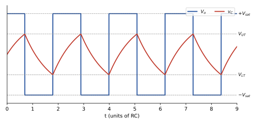

## The Operational Amplifier
An Op-Amp has three terminals (excluding the 2 powering terminals) that include the inverting input ($-$), the non-inverting input ($+$) and the output ($O$). The output voltage is related to the inputs by the following equation

$$
V_o = A\,(V_+ - V_-), \tag{1}
$$

where $A$ is the (open-loop) gain of the Op-Amp. In real devices $A$ is very large ($\sim 10^5$), so the output can never exceed the supply rails and is limited to the saturation voltages $\pm V_{sat}$:

$$
V_o =
\begin{cases}
+V_{sat}, & V_+ > V_- \\
-V_{sat}, & V_+ < V_-
\end{cases}
\tag{2}
$$

In this case, the Op-Amp acts as a comparator. When the difference is positive, the output voltage approaches the positive saturation voltage and vice versa.

For the analysis we assume an ideal Op-Amp, i.e. one that

- draws near zero current through its $\pm$ input terminals ($I_+ = I_- \approx 0$, infinite input resistance),

- has a very large gain $A \to \infty$ (so that, whenever negative feedback is present, $V_+ - V_- = V_o/A \to 0$),

- has zero output resistance.

Throughout this report the saturation voltages are taken as $\pm V_{sat} = \pm 10$ V (the Op-Amps are powered from $\pm 12$ V supplies).

## Astable Multivibrator

### Circuit and threshold voltages
The astable multivibrator is built from one Op-Amp, a timing network $R$–$C$ connected between the output and the inverting input, and a resistive divider $R_1$–$R_2$ that feeds a fraction of the output back to the non-inverting input (Fig. 1).

*Figure 1: Astable multivibrator (square wave generator) using an Op-Amp.*

Assuming an ideal Op-Amp (that draws near zero current through its $\pm$ terminals), the voltage at the non-inverting input is simply the voltage divider formed by $R_1$ and $R_2$ across the output:

$$
V_+ = \frac{R_2}{R_1 + R_2}\, V_{out}. \tag{3}
$$

Let the factor be $\beta$,

$$
\beta = \frac{R_2}{R_1 + R_2}, \quad \text{hence } V_+ = \beta\, V_{out}. \tag{4}
$$

Since $V_{out}$ can only be $+V_{sat}$ or $-V_{sat}$ (Eq. 2), the circuit has two thresholds, the upper and lower threshold voltages

$$
V_{UT} = +\beta V_{sat}, \qquad V_{LT} = -\beta V_{sat}. \tag{5}
$$

As the two resistances are equal ($R_1 = R_2 = 10$ k$\Omega$), $\beta = \frac{1}{2}$ and the positive and negative threshold voltages are $\beta V_{out}$ and $-\beta V_{out}$ respectively, i.e. $\pm 5$ V for $V_{sat} = 10$ V.

### Charging and discharging of the capacitor
The charge/discharge path of the capacitor involves the ground, the capacitor, $R$ and the Op-Amp output. Therefore the time constant is $RC$. Applying Kirchhoff's current law at the inverting node (no current enters the Op-Amp), the current through $R$ is the current into the capacitor:

$$
\frac{V_{out} - v_C}{R} = C\frac{dv_C}{dt}
\quad\Longrightarrow\quad
\frac{dv_C}{dt} + \frac{v_C}{RC} = \frac{V_{out}}{RC}. \tag{6}
$$

For a constant $V_{out}$ this first-order equation has the solution

$$
v_C(t) = V_{out} + \left(v_C(0) - V_{out}\right) e^{-t/RC}, \tag{7}
$$

where $v_C(0)$ is the capacitor voltage at the instant the output last switched. The capacitor voltage is equal to $V_-$, and the output flips whenever $V_-$ crosses $V_+$.

Now consider the case where the capacitor is initially uncharged and $V_{out}$ is set at $+10$ volts (let the saturation voltages be $\pm 10$ V). From Eq. (7),

$$
v_C(t) = V_{sat}\left(1 - e^{-t/RC}\right). \tag{8}
$$

The capacitor charges, approaching $+10$ V, but when it crosses $5$ V, $V_- = 5$ V $= V_+$, the threshold is met and the output is inverted to $-10$ V. (This first rise from $0$ to $\beta V_{sat}$ takes $t_0 = RC \ln \frac{1}{1-\beta} = RC \ln 2$, which is shorter than all later half-cycles and appears as the shorter first pulse in Fig. 2.) The capacitor now discharges towards $-10$ V while $V_+ = -5$ V; $V_-$ stays at $5$ V initially as the capacitor voltage cannot change instantaneously. Again, the capacitor reaches $V_{LT} = -5$ V and that is when the swap happens again. This repeats multiple times and that is the working of the Astable multivibrator circuit.

*Figure 2: Output voltage $V_o$ (square wave) and capacitor voltage $v_C$ of the astable multivibrator for $\beta = \frac{1}{2}$ (time axis in units of $RC$).*

### Time period
Consider the instant just after the output has switched to $+V_{sat}$. The capacitor then starts at $v_C(0) = V_{LT} = -\beta V_{sat}$ and charges towards $+V_{sat}$ until it reaches $V_{UT} = +\beta V_{sat}$ after a time $T_1$. Using Eq. (7):

$$
\beta V_{sat} = V_{sat} + \left(-\beta V_{sat} - V_{sat}\right) e^{-T_1/RC} = V_{sat} - V_{sat}(1+\beta)\, e^{-T_1/RC}. \tag{9}
$$

This equation governs the behaviour of the capacitor and hence we obtain the duration of one half cycle. Cancelling $V_{sat}$ and solving for $T_1$:

$$
(1+\beta)\, e^{-T_1/RC} = 1 - \beta \quad\Longrightarrow\quad e^{T_1/RC} = \frac{1+\beta}{1-\beta}, \tag{10}
$$

$$
T_1 = RC \ln\left(\frac{1+\beta}{1-\beta}\right). \tag{11}
$$

The discharge from $+\beta V_{sat}$ to $-\beta V_{sat}$ (towards $-V_{sat}$) is identical by symmetry, $T_2 = T_1$, so the output is a square wave with $50\%$ duty cycle and the time period of one full cycle is

$$
T = T_1 + T_2 = 2RC \ln\left(\frac{1+\beta}{1-\beta}\right) \qquad \text{(symmetric resistances)}, \tag{12}
$$

giving the frequency

$$
f = \frac{1}{T} = \frac{1}{2RC \ln\left(\dfrac{1+\beta}{1-\beta}\right)}. \tag{13}
$$

Note that $V_{sat}$ cancels out, so the frequency does not depend on the supply voltage, only on $R$, $C$ and $\beta$. For $R_1 = R_2$ we have $\beta = \frac{1}{2}$, $\ln \frac{1+\beta}{1-\beta} = \ln 3 \approx 1.0986$ and therefore

$$
T = 2RC \ln 3 \approx 2.197\, RC, \qquad f = \frac{1}{2RC \ln 3} \approx \frac{0.455}{RC}. \tag{14}
$$

The resistor needed for a required note frequency $f$ and a chosen capacitor $C$ is therefore

$$
R = \frac{1}{2 f C \ln 3}. \tag{15}
$$